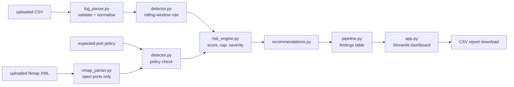

# SentinelLite
**Lightweight Security Event Detection and Risk Analysis Dashboard** - Cloud and Network Security mini-project

SentinelLite is a small, local, offline tool that reads **authentication logs** (CSV) and **Nmap scan reports** (XML),
detects suspicious activity with transparent rules, gives each finding an **explainable risk score**, and suggests
**defensive** actions. It is an educational project - **not** a production IDS or SIEM.

## 1. Problem statement
Security teams and students are often handed raw logs and scan output. Spotting brute-force login attempts and
unexpectedly exposed services by eye is slow and error-prone. SentinelLite shows how simple, auditable rules can turn
raw events into prioritised, explained findings.

## 2. Features
- **Authentication analysis:** validates the CSV, skips malformed rows with clear warnings, and detects repeated failed
  logins from one IP using a **rolling 2-minute window**.
- **Network analysis:** parses Nmap XML (hosts, IPs, open ports, services) and compares open ports with an **editable
  expected-port policy**.
- **Explainable scoring:** every finding shows the rule that fired and the score arithmetic; scores are capped at 100.
- **Defensive recommendations:** review logs, verify the source IP, rate limiting, review firewall rules, verify the port inventory.
- **Dashboard:** metrics, severity chart, filters (severity, source IP), colour-coded alert table, per-alert explanation,
  data tables, CSV/XML upload, a "Clear uploaded files" button, CSV report download, and cards showing which uploaded
  file each result came from. **The page is empty until you upload a file; there is no built-in demo data.**
- **CLEAN / ALERT verdict:** a coloured banner states whether the loaded data is CLEAN or ALERTS RAISED (Medium/High), per source and overall; empty input is reported as NO DATA, never as clean.
- **Safe by design:** no scanning, no blocking, no firewall or host changes, no network access at run time.

## 3. Architecture and data flow


| File | Role |
|---|---|
| `app.py` | Streamlit dashboard (UI only) |
| `pipeline.py` | Connects parsers → detectors → scoring → findings table; CSV export |
| `log_parser.py` | Reads and validates the authentication CSV |
| `nmap_parser.py` | Reads Nmap XML (rejects XML entity declarations) |
| `detector.py` | Rolling-window login rule, port-policy parser and check |
| `risk_engine.py` | Rule points, de-duplication, cap, severity bands |
| `recommendations.py` | Defensive advice per rule (and per well-known port) |
| `expected_ports.txt` | Default expected-port policy (editable in the app) |
| `test_files/` | Synthetic CSV and XML files you upload to check the app (see `TEST_FILES.md`) |
| `tests/` | Automated pytest suite (its synthetic data lives in `tests/fixtures/` and is never loaded by the app) |

## 4. Technologies
Python 3.9+, Streamlit, pandas, Python standard library (`csv`, `ipaddress`, `xml.etree`, `datetime`), pytest.

## 5. Prerequisites
Python 3.9 or newer, and an internet connection **only for the one-time dependency install**.

## 6. Windows - install and run
Double-click **`run_windows.bat`** (or run it from Command Prompt). It checks Python, creates `.venv`, installs
`requirements.txt`, runs the tests, and starts the app **only if the tests pass**. Open <http://localhost:8501> if the
browser does not open by itself. Manual alternative:
```bat
py -3 -m venv .venv
.venv\Scripts\activate
pip install -r requirements.txt
streamlit run app.py
```

**One-click compile + test + run:** `compile_and_run.bat` (Windows) or `./compile_and_run.sh` (macOS/Linux) install dependencies, compile every `.py` file (`compile_check.py`), run the tests, then start the app.

## 7. macOS / Linux
```bash
chmod +x run_unix.sh
./run_unix.sh
```
or manually: `python3 -m venv .venv && source .venv/bin/activate && pip install -r requirements.txt && streamlit run app.py`

## 8. Uploading your own data
Use the sidebar. **CSV** columns: `timestamp, source_ip, username, status` (`SUCCESS`/`FAILED`). Timestamps are ISO style
(`2026-10-19 09:15:00`, optional `T`/`Z`/offset) or `DD/MM/YYYY HH:MM:SS`. **Nmap XML:** create it yourself, against
localhost or a lab machine you own or are authorised to test:
```bash
nmap -sV -oX my_scan.xml 127.0.0.1
```
Edit the **expected-port policy** box (`HOST PORT/PROTOCOL`, `*` = any host, ranges allowed). Press **Clear uploaded files** to return to the empty start page.

Ready-made files and their expected results are in `test_files/` and `TEST_FILES.md`.

## 9. Detection rules and scoring
Window: failures from the **same IP** whose first and last timestamps are at most **120 seconds apart (inclusive)**.
Overlapping windows are merged into one incident, so each failure is counted once.

| Rule | Trigger | Points | Severity |
|---|---|---|---|
| `AUTH-BRUTE-FORCE` | 5+ failures from one IP in a rolling 120 s window | **70** (brief) | High |
| `AUTH-FAILURE-BURST` | 2-4 failures in the window | 40 (project assumption) | Medium |
| `AUTH-ISOLATED-FAILURE` | failures that never shared a window | 10 (project assumption) | Low |
| `PORT-UNEXPECTED` | open port not allowed by the policy (default-deny) | **30** (brief) | Medium |

**Combined score** per IP: rules are grouped into families (`AUTH-FAILURES`, `PORT-EXPOSURE`); only the **highest rule per
family** counts (3 unexpected ports = 30, not 90); family points are summed and **capped at 100**.
**Severity:** 0-29 Low · 30-59 Medium · 60-100 High.
The scores are **illustrative project-defined values, not validated probabilities of compromise.** The 40 and 10 values
are this project's own assumptions (the brief fixes only 70 and 30) and can be changed in the sidebar.

## 10. Tests
```bash
pytest -q
```
The suite covers normal logins, isolated failures, repeated failures, rolling windows, malformed CSV/XML, Nmap parsing,
unexpected ports, score boundaries, the 100 cap, de-duplication and CSV export.

## 11. Example demonstration workflow (about 2 minutes)
1. Start the app: it shows **No data loaded yet** and no results.
2. Upload `test_files/alert_logs.csv` in the first box and `test_files/alert_scan.xml` in the second.
3. Read the verdict banner (ALERTS RAISED - HIGH RISK) and the metrics: 15 events, 4 alerts (1 High, 3 Medium).
4. Open **Explain an alert** on the High alert: rule, threshold, usernames targeted, score breakdown, recommendations.
5. Edit the policy (add `127.0.0.1 21/tcp`) and watch the FTP alert disappear.
6. Click **Clear uploaded files**, upload `clean_logs.csv` and `clean_scan.xml`: the verdict is **CLEAN**.
7. Upload `logs_with_errors.csv` to show validation messages; click **Download findings (CSV)**.

## 12. Limitations and future improvements
- Rule-based only: no learning, no threat intelligence, no geo-IP, no live log collection.
- IP-based grouping can mislead behind NAT/proxies; a distributed attack from many IPs is not correlated.
- The policy is host-and-port only (no service/version checks, no CIDR ranges).
- Scores are illustrative; thresholds are not tuned on real traffic.
- Tested only on small synthetic files. Future work: password-spraying rule, CIDR policy, Windows/Linux log formats, alert history.

## 13. Ethical and authorised-use statement
Use SentinelLite only on data from systems you **own or have written permission** to assess. Run Nmap only against
localhost or an explicitly authorised lab machine. The tool never scans, blocks or reconfigures anything. Test-file IPs use
documentation ranges (`192.0.2.0/24`, `198.51.100.0/24`, `203.0.113.0/24`) and private lab addresses; all names are fictional.
